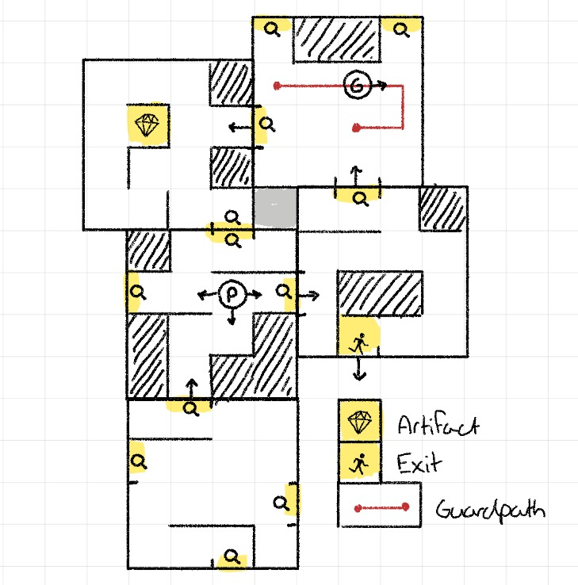
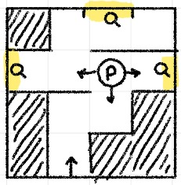

__PROJECT VAN PERNA LEVISON__
# Magic Maze

Het doel van het project is om een virtual single player versie van het bordspel Magic Maze te maken. Magic Maze is een 2-6 speler spel waarin samenwerking en tijdsdruk grote rollen spelen. Omdat samenwerking niet iets is wat in single player gedaan kan worden zullen er bepaalde extra features worden toe gevoegd om beide de tijdsdruk hoger te maken en de movement (waar de samenwerking in de fysieke versie van het spel om gaat) wat lastiger te maken. Als mogelijk is (na de basis van het spel klaar is) ga ik kijken of ik wat rogue like of lite features kan toe voegen.

### Het Spel

In Magic Maze speel je met je vrienden een groep van 4 adventureres die 4 artifacts moeten stelen uit een museum. Het museum word opgebouwd uit een selectie aan kaarten (map delen) die aan het begin van het spel geschud worden, elke keer als door een deur gelopen word waar nog geen connectie aan is word er een nieuwe kaart getrokken en aan gelegd. Hierdoor ontstaat er elke keer dat er gespeeld word een nieuwe unieke map (randomly generated). 
Zodra de spelers alle 4 de artifacts hebben gevonden (en gepakt) gaat het alarm van het museum af en moetten de adventurers zo snel mogelijk het museum uit gaan (naar een exit die ook op de map ontdekt moet worden). 
De difficulty van het spel ontstaat door het feit dat tijdens dit alles de spelers niet met elkaar mogen praten en ieder een andere manier van beweging van alle 4 adventurers controleerd (NSWE, teleporteren, roltrappen en map discoveries). Hierdoor moet iedere speler erg goed opletten waar hij/zij een adventurer moet bewegen en moet iedereen constant multitasken.

### Hoe vertaalt dit naar een game?

Niet alle onderdelen van het fysieke bordspel kunnen goed vertaald worden naar een game. De map generation zal makkelijk kunnen worden gedaan maar de aanpassing naar een single player versie is waar de grootste challenge in het project ligt.

Dus een aantal extra/veranderde features:
- Er zal maar 1 adventurer zijn en dus maar 1 artifact om te stelen
- Alleen het map deel waar de speler op staat zal zichtbaar zijn elk moment (mogelijk een minimap die toggelable is als makkelijkere difficulty optie)
- Movement zal turnbased op een grid zijn. De turnbased quality komt vooral in spel omdat ik op bepaalde mapdelen (kaarten) guards wil toevoegen die kleine rondjes lopen die de speler zal moeten ontwijken.
- De timer die afloopt na dat het allarm af is gegaan zal los van deze turns zijn waardoor de speler gahaaste beslissingen zal moeten maken.
- Guard Allertness: hoe langer de speler in het museum blijft hoe groter de allertness van de guards zal zijn, als een bepaalde treshold word overschreden zal het allarm in het museum vervroegd af gaan waardoor de speler minder tijd heeft om de artifacts te stelen of zonder zijn/haar prijs het museum uit zal moetten. Elke keer als de speler gespot word door de guards zal er een spike zijn in hun allertness.

## Een aantal vragen

__Wat is het probleem (niet de oplossing) dat jouw project gaat oplossen.__

Magic Maze is een erg leuk spel maar je hebt andere mensen nodig om het te spelen, ook veroorzaakt de tijdsdruk en lastige samenwerking in het spel vaak lichterlijke ruzie tussen de spelers. Om het spel vaker te kunnen spelen zonder andere mensen nodig te hebben en om te vermijden ruzie te krijgen met je vrienden ga ik dus een virtual single player versie van het spel maken.

__Wie zijn je verwachte gebruikers? In andere woorden, voor wie bouw je dit project?__

Ik bouw dit project voornamelijk voor mezelf, maar andere mensen die dit soort spellen leuk vinden kunnen het ook gebruiken.

__In welke setting wordt je project gebruikt?__

Waarschijnlijk zal het alleen voor laptop/pc worden gebouwd. Het is eenmaal een single player spel.

## Schets

__Globale Map View:__

__Player View:__

## Features

- __Start Screen:__ Een start game button (optional: zodra hier op geklikt word kunnen de run settings ingesteld worden)
- __Map generation:__ Een x hoeveelheid aan kaarten zullen moeten worden gemaakt en opgeslagen worden in b.v. een list waarin ze gescrambled kunnen worden. Wanneer een nieuwe kaart word aangelegd moet zijn locatie worden opgeslagen en moet er gekeken worden of er neighbouring kaarten zijn waar ze op aansluiten. 
- __Movement:__ NSWE op een grid
- __Guards:__ Maak een standerdized path waar ze op lopen, voeg een vision range toe (visible voor de speler) waarin de adventurer gespot kan worden. 
- __Turns:__ Zorg er voor dat de speler en de guards omstebeurt lopen.
- __Guard Allertness:__ Elke X seconden gaat dit met Y omhoog, guards spiken dit met Z. Hou een vaste treshhold voor het alarm bij.
- __Het Alarm:__ Zodra de allertness een bepaalde treshhold overschrijd of als het artifact gestolen is moet er een alarm afgaan. Dit start een timer van X minuten en als de speler niet optijd ontsnapt pakken de guards hem en moet er een Game Over screen verschijnen. Nadat het alarm afgegaan is betekent gespot worden door de guards automatische game over!

- __Settings (optional):__ Difficulty adjustment (hoeveelheid kaarten in de mix), minimap aan of niet, tijd na alarm om te ontsnappen aanpassen, snelheid van de allertness die omhoog gaat
- __Character Selection (optional):__ In het originele bordspel waren er 4 adventurers met andere special abilities, wellicht kunnen deze ook geintegreerd worden.
- __Minimap (optional):__ Hou een greyed out area bij in een bovenhoek van het spel waarin alle mapareas die ontdekt zijn zichtbaar zijn en de locatie van de speler.

### Rogue Elements

In de basis versie van het spel zal het geen meta upgrades hebben. Omdat ik dit wel leuk vind zal ik ze toevoegen als ik er tijd voor heb

- __Meta Currency:__ Alleen verkrijgbaar als de speler niet gepakt word door de Guards. Hiermee kunnen Upgrades gekocht worden.
- __Upgrades:__ De minimap, hogere difficulties en optionele characters zullen hier onder worden verschaard. Hierbij kunnen mogelijk positieve kaarten worden gekocht en toegevoegd worden aan het deck en misschien kan de card draw voor nieuwe map areas uitgebreid worden naar een keuze uit 2 of 3 kaarten waardoor de map voordeliger word voor de speler.
- __Side Objectives:__ Deze geven meer meta currency na de run en mogelijk zijn unlock requirements voor bepaalde upgrades (als in je kan je alleen kopen nadat ze unlocked zijn). Elk side objective completed spiket de guard allertness dus let hier op!

## Requirements

None

## Moeilijke Onderdelen

- Map generation -> connection tot eerder geplaatste kaarten. Terug val: maak het gewoon 1 grote map waarbij de connections geen muur hebben en dus automatisch als connectie werken als dit aan beide kanten zo is.
- Turnbased movement -> moet uitvinden hoe dit moet
- Guards -> movement path, wil graag dit gestandaardiseert doen, aka ik kan op de map een pad tekenen en dit aan mijn guard object geven en dan loopt hij dit pad automatisch.
